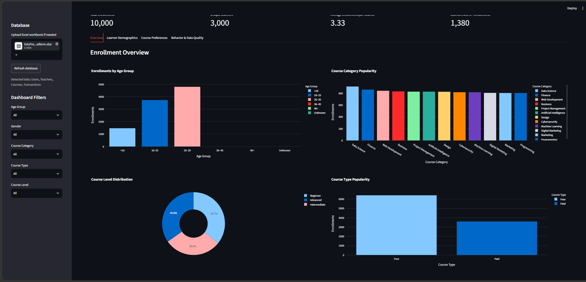
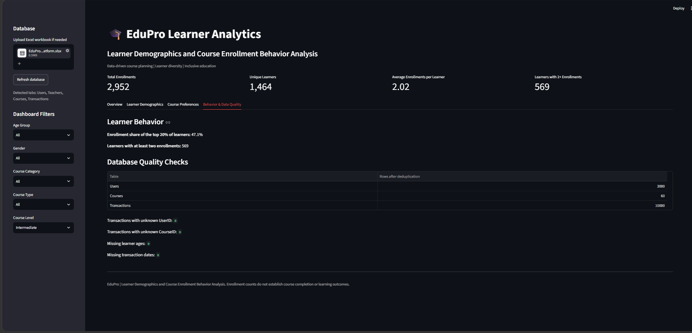
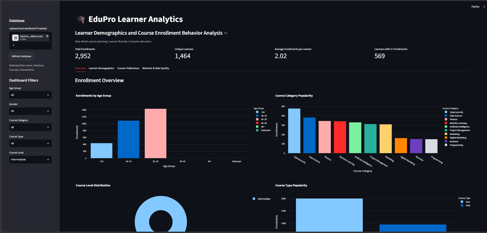

# EduPro Analytics — Learner Analysis

**Turning learner data into meaningful educational insights using Google Sheets.**

## 📌 Project Overview

EduPro Analytics is an educational data analysis project designed to organize, analyze, and visualize learner-related data using Google Sheets. The project aims to make learner performance easier to understand through data cleaning, spreadsheet formulas, analysis, and visual reporting.

## 🎯 Project Objectives

- Organize learner data in a structured format.
- Analyze learner performance and academic trends.
- Identify patterns and areas for improvement.
- Use spreadsheet formulas and functions to summarize data.
- Present findings through charts, graphs, and dashboards where applicable.
- Support data-driven educational decisions.

## 🛠️ Tools & Technologies

- **Google Sheets** — Data organization, analysis, formulas, and visualization
- **Spreadsheet Functions** — Calculations and data summarization
- **Charts & Graphs** — Visual representation of learner data

## ⚙️ Project Workflow

1. **Data Collection:** Gather the available learner dataset.
2. **Data Preparation:** Organize the data and check for missing or inconsistent values.
3. **Data Analysis:** Apply appropriate spreadsheet formulas and functions.
4. **Visualization:** Create charts and graphs to communicate trends.
5. **Insights:** Summarize findings and identify opportunities for improvement.

## 📊 Key Features

- Structured learner data management
- Learner performance analysis
- Spreadsheet-based calculations
- Visual reporting using charts and graphs
- Insight generation to support educational analysis


## 📁 Project Structure

```text
EduPro_GoogleSheets_Project/
├── README.md
└── project files
```

## 🚀 How to Use

1. Clone or download this repository.
2. Open the project files included in the repository.
3. If a Google Sheets link is provided, open it to explore the analysis.
4. Review the formulas, charts, and findings available in the project.

## 💡 Learning Outcomes

- Practical experience with spreadsheet-based data analysis
- Understanding of data cleaning and organization
- Experience interpreting learner performance trends
- Improved data visualization and reporting skills

## 🔮 Future Improvements

- Build an interactive dashboard using Looker Studio or Power BI.
- Perform deeper analysis using Python, Pandas, and Matplotlib.
- Automate recurring reports.
- Add more learner performance metrics where suitable.

## 👩‍💻 Author

**Sukla Dey**

- GitHub: [@sukladey](https://github.com/sukladey)
- Portfolio: [View Portfolio](https://portfolio-sukla-dey.vercel.app/)

---

If you find this project useful, consider giving the repository a ⭐ on GitHub.


## 📸 Project Screenshots

### 1. Dashboard Overview


### 2. Learner Data


### 3. Analysis and Visualization

